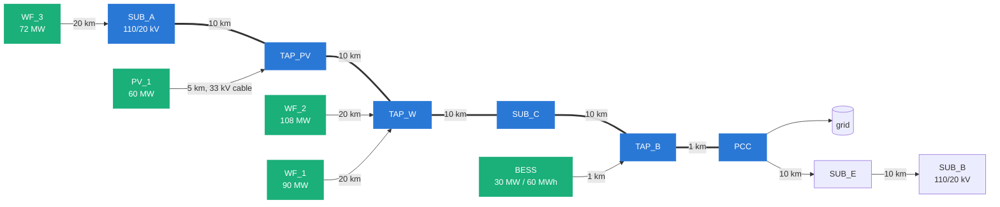

# Example network description

A generic 110 kV corridor exporting 330 MW of wind and solar to the grid. Values
are representative, from public standards and typical datasheets;
Available in [`constants.py`](../src/corridor_sim/constants.py).

* **Constrained corridor:** `SUB_A → PCC`, 41 km. Zone Z1 is `SUB_A → SUB_C` (30 km),
  zone Z2 is `SUB_C → PCC` (11 km).
* **Bearings:** each zone picks 0°, 30°, 45°, 60° or 90° (default 45° for both).
  Only matters for full-weather rating.
* **Topology is fixed:** a disconnected plant is set to zero output, not removed,
  so every scenario shares one network. Added plants and loads are the exception:
  they add what they need, below.

## Connection points

Added plants (`--add-der`) and large loads (`--add-load`) connect at one of five
110 kV points along the corridor:

| Point | From SUB_A | Where | Zone |
|---|---|---|---|
| `SUB_A` | 0 km | corridor head, where WF_3 joins | Z1 |
| `MID_A_C` | 15 km | midway from SUB_A to SUB_C, inside TAP_PV → TAP_W | Z1 |
| `SUB_C` | 30 km | substation between the two rating zones | Z1 / Z2 |
| `MID_C_PCC` | 35.5 km | midway from SUB_C to the PCC, inside SUB_C → TAP_B | Z2 |
| `PCC` | 41 km | grid interface, beyond the constrained corridor | — |

A midpoint bus is only built while something connects to it. The segment it sits
on is then built as two halves of the same conductor, named `<segment>_1` and
`<segment>_2`:

| Midpoint | Segment | Halves |
|---|---|---|
| `MID_A_C` | `CORR_PV_W`, 10 km | `CORR_PV_W_1` TAP_PV → MID_A_C, 5 km; `CORR_PV_W_2` MID_A_C → TAP_W, 5 km |
| `MID_C_PCC` | `CORR_C_B`, 10 km | `CORR_C_B_1` SUB_C → MID_C_PCC, 5.5 km; `CORR_C_B_2` MID_C_PCC → TAP_B, 4.5 km |

A study with nothing at a midpoint builds exactly the network it always did.

## Battery location

The battery connects at TAP_B, 1 km before the PCC, unless `--storage-at` (or
`storage_at` from Python) places it at `SUB_A`, `MID_A_C`, `SUB_C`, `MID_C_PCC` or the
`PCC`. Wherever it is, it joins over the same 1 km 110 kV tie (`LAT_BESS`) and 40 MVA
110/33 kV transformer (`T_BESS`), or straight onto the busbar with
`storage_connection="direct"`. A battery that is switched off stays at TAP_B, so its
place never changes a network it is not part of.

Where it sits decides what it can do for the corridor: its power flows through every
segment between its point and the PCC, and none upstream of it. Before any plant is
curtailed it holds back discharge and charges with power that would be curtailed,
for the export cap and for overloads on those segments
([methodology](methodology.md#5-battery)). Moving it also moves where its reactive
power supports the voltage, and where its discharge and grid charging load the
corridor.

## Added plants and loads

| | Added plant | Added load |
|---|---|---|
| Names | `WF_4`, `WF_5`, … (wind), `PV_2`, `PV_3`, … (solar) | `LOAD_1`, `LOAD_2`, … |
| Size | any rating up to 1000 MW | any demand up to 1000 MW |
| Connection | own 110/33 kV step-up transformer `T_<name>`, 1.25 × rating MVA, 12 % impedance (as T_PV is to PV_1), on the 110 kV busbar of its point | straight on the 110 kV busbar |
| Output or demand | wind: the 6 MW turbine curve on the shipped weather, as WF_1–WF_3, at site exposure 1.0; solar: `pv_generation.csv` scaled from PV_1's 60 MW to its rating | constant at its rating, unity power factor unless given (`80@SUB_C:0.95`) |
| Reactive | cos φ 0.95 range, the same droop or cos φ control as the built-in plants (solar follows the solar setting), measured at its point | fixed by its power factor |
| Curtailment | yes, see below | never |

The upper bound is a guard against a mistyped number, not a network limit. The
corridor is long and weak for demand at its far end: with no generation, a 100 MW
load at SUB_A leaves the busbar near 0.86 pu, and somewhere between 130 and 140 MW
the power flow has no solution at all. Steps beyond what the network can supply do
not converge, and are counted as such.

**Where it connects decides what it is curtailed for.** Curtailment is proportional
to instantaneous output: every plant cut in a step gives up the same share of what it
is producing. A plant is only in that share for a corridor overload if its power
flows through the overloaded segment, that is if it joins at or upstream of the
segment's head-side end; a plant at the PCC is not. When the export cap, an
over-voltage or a transformer overload binds in the same step, every plant shares
the cut.

**A large load absorbs generation before anything is cut.** The cut is searched on
the solved network, so power a load draws between the plants and the bottleneck
never reaches the bottleneck: a 60 MW load at MID_A_C takes about 60 MW off the
curtailment a TAP_W → SUB_C overload needs, and a load large enough to use the whole
excess leaves nothing to cut. A load beyond the bottleneck (at the PCC, say) relieves
the export cap but not the corridor. A segment overloaded by power drawn back toward
the head, to supply a large load up the corridor, is recorded but not curtailed for:
cutting generation would only deepen it.

Added plants also widen the reactive exchange window at the PCC, which is set by the
installed fleet: 10 % of 330 MW plus what was added, at most 50 MVAr.

## Corridor conductor (Al/St 340/30)

| | Single | Twin bundle |
|---|---|---|
| Name in outputs | 1-Duck | 2-Duck |
| AC resistance at 50 °C | 0.0973 Ω/km | 0.0486 Ω/km |
| Reactance | 0.400 Ω/km | 0.290 Ω/km |
| Static rating | 780 A (149 MVA) | 1560 A (297 MVA) |
| Rating cap (2 ×) | 1560 A | 3120 A |
| Series equipment | 1600 A | 3150 A |

Design temperature 80 °C, diameter 25 mm.

## Plants

| Plant | Rating | Connection | Reactive range |
|---|---|---|---|
| WF_1 | 15 × 6 MW = 90 MW | 20 km lateral to TAP_W | ±29.6 MVAr |
| WF_2 | 18 × 6 MW = 108 MW | 20 km lateral to TAP_W | ±35.5 MVAr |
| WF_3 | 12 × 6 MW = 72 MW | 20 km lateral to SUB_A | ±23.7 MVAr |
| PV_1 | 60 MW | 110/33 kV + 5 km cable at TAP_PV | ±19.7 MVAr |
| BESS | 30 MW / 60 MWh | 110/33 kV + 1 km tie at TAP_B (or `--storage-at`) | ±9.9 MVAr |

Reactive range is cos φ 0.95 at rated power.

## Transformers

| Asset | Rating | Impedance | Taps |
|---|---|---|---|
| T_SUB_A1 / T_SUB_A2 | 25 / 16 MVA, 110/20 kV | 10.4 / 10.2 % | on-load, ±9 × 1.67 % |
| T_SUB_B | 25 MVA, 110/20 kV | 9.7 % | on-load, ±9 × 1.67 % |
| Wind step-up (2 per farm) | 50 MVA ONAN / 63 MVA ONAF | 12.5 % | fixed |
| T_PV / T_BESS | 75 / 40 MVA, 110/33 kV | 12.0 % | fixed |

## Limits and settings

| | Value |
|---|---|
| Voltage band | 0.95 – 1.05 pu |
| Export cap at the PCC | 250 MW |
| Reactive exchange window | ±33 MVAr (10 % of the installed fleet, at most 50 MVAr) |
| Reactive import guard | 20 MVAr |
| Grid impedance behind the PCC | 2.0 + j10.0 Ω |
| MV tap-changer setpoint | 20.5 kV |
| MV shunt reactor | 11 steps, 0.50 – 3.00 MVAr |
